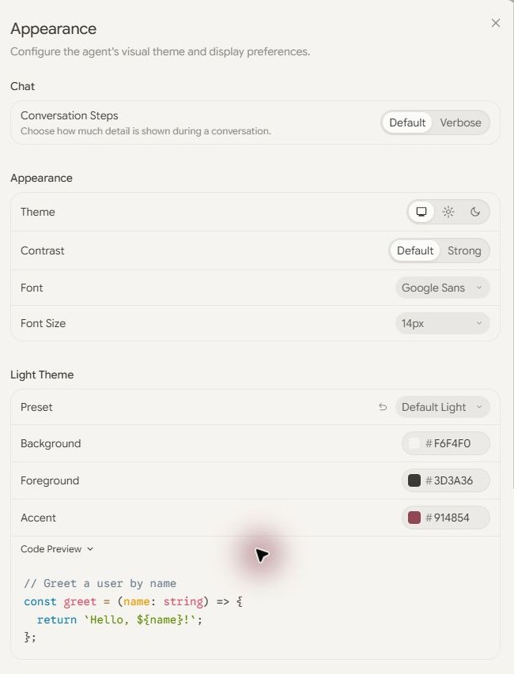
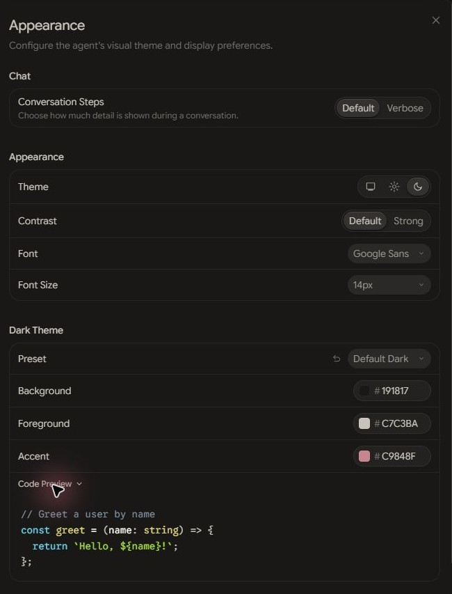

# Serein for Antigravity App — Minimalist Warm Palette Preset

**Extreme minimalism. Everyday comfort.**

Serein for Antigravity App brings soft, low-distraction visual comfort to your agentic workflows and coding canvas. Eliminate bright glare with carefully balanced warm surface tones:

- **Serein Alabaster (Light):** Gentle ivory canvas with readable dark typography for daytime work.
- **Serein Obsidian (Dark):** Warm charcoal canvas that keeps late-night sessions comfortable and glare-free.

[Download Latest Release](https://github.com/cmduyeen/serein-antigravity/releases/latest) · [Full Serein Suite](https://github.com/cmduyeen/serein-theme) · [Read Workflow Guide](https://cmduyeen.github.io/)

---

## Preview

| Serein Alabaster · Light Mode | Serein Obsidian · Dark Mode |
|---|---|
|  |  |

---

## Installation

1. Open Antigravity App and navigate to **Settings → Appearance**.
2. Apply the color values specified in `presets.json` for Background, Foreground, and Accent tokens.
3. You can run `./copy-color.ps1 -Color Background` in PowerShell to quickly copy specific hex values.

---

## Complete the Serein Workspace

Pair your Antigravity workflows with your local development tools:

- 💻 **[Serein for VS Code](https://github.com/cmduyeen/serein-vscode)** — Clean code editor theme.
- 💻 **[Serein for Neovim](https://github.com/cmduyeen/serein-neovim)** — Native Lua terminal colorscheme.
- 🖥️ **[Serein for Windows Terminal](https://github.com/cmduyeen/serein-terminal)** — Warm console color scheme.
- 📓 **[Serein for Obsidian](https://github.com/cmduyeen/serein-obsidian)** — Distraction-free markdown notes.
- 🌐 **[All 10+ Serein Ports](https://github.com/cmduyeen/serein-theme)** — The central hub and design specifications.

---

## Honest Design & Limitations

Themes are aesthetic preferences and visual comfort tools, not medical treatments. Serein has not been clinically tested to treat eye strain. Ambient lighting, glare control, and regular breaks remain essential.
- [American Academy of Ophthalmology: Computer Usage Guidance](https://www.aao.org/eye-health/diseases/computer-usage)
- [Full design reference & limitations](https://github.com/cmduyeen/serein-theme/blob/main/REFERENCE.md)

---

## Author & License

Created and maintained by **[Dyn (cmduyeen)](https://cmduyeen.github.io/)**.
- Personal Blog: [cmduyeen.github.io](https://cmduyeen.github.io/)
- GitHub: [@cmduyeen](https://github.com/cmduyeen)

Released under the [MIT License](LICENSE).
